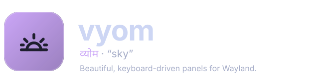
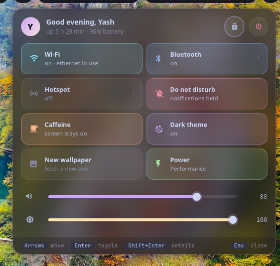
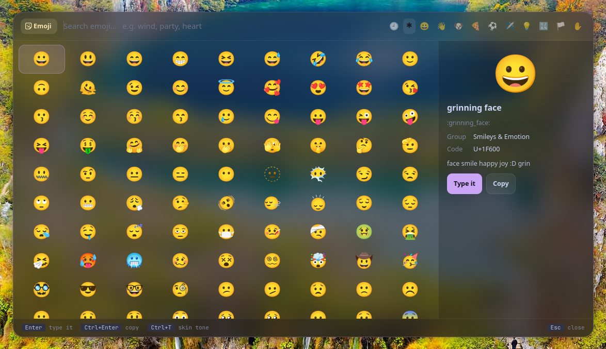

<p align="center">
  <picture>
    <source media="(prefers-color-scheme: dark)" srcset="assets/banner-dark.svg">
    <source media="(prefers-color-scheme: light)" srcset="assets/banner-light.svg">
    
  </picture>
</p>

<p align="center">
  <b>Beautiful, keyboard-driven panels for wlroots desktops (sway, Hyprland, river…).</b><br>
  The runtime behind <a href="https://github.com/Theyashsawarkar/vayu">Vayu</a>'s launcher and system panels; works on its own.
</p>

<p align="center">
  <a href="https://github.com/Theyashsawarkar/vyom/actions/workflows/ci.yml"></a>
  <a href="https://github.com/Theyashsawarkar/vyom/releases"></a>
  <a href="LICENSE"></a>
  
  
  
</p>

<p align="center">
  
</p>

<p align="center">
  
  
</p>

> *Vyom* (व्योम) is Sanskrit for "sky": the space everything sits in.

Vyom replaces wofi in Vayu. Instead of scripts piping text rows into a
generic list, each job is a **tool**: a small plugin with real layouts,
live data, previews, toggles and a key for everything. Vyom is what they
run in: one resident process with a shared panel, theme and plugin API, so
every tool opens instantly and looks the same.


## Contents

- [The tools](#the-tools)
- [Install](#install)
- [Usage](#usage)
- [Configuration](#configuration)
- [Writing a tool](#writing-a-tool)
- [Troubleshooting](#troubleshooting)
- [Contributing](#contributing)
- [License](#license)

## The tools

**Each tool is its own repository**, so you install only the ones you want:

| Tool | | What it does |
|---|---|---|
| [dvara](https://github.com/Theyashsawarkar/dvara) | द्वार, gateway | app launcher: frequent apps first, app actions, open windows |
| [ganit](https://github.com/Theyashsawarkar/ganit) | गणित, mathematics | calculator: answers as you type, units, currency, history |
| [smriti](https://github.com/Theyashsawarkar/smriti) | स्मृति, memory | clipboard history: links, images, code told apart; pins |
| [bhava](https://github.com/Theyashsawarkar/bhava) | भाव, feeling | emoji: a grid, recents, skin tones; types it for you |
| [tarang](https://github.com/Theyashsawarkar/tarang) | तरंग, wave | Wi‑Fi with live signal, inline passwords, and the hotspot |
| [setu](https://github.com/Theyashsawarkar/setu) | सेतु, bridge | Bluetooth: devices with battery, discovery, pairing |
| [doot](https://github.com/Theyashsawarkar/doot) | दूत, messenger | your phone (KDE Connect): battery, send files, ring, browse |
| [patra](https://github.com/Theyashsawarkar/patra) | पात्र, vessel | Docker: containers by project, live CPU/memory, logs |
| [suchana](https://github.com/Theyashsawarkar/suchana) | सूचना, notice | notifications: on screen with actions, history, do not disturb |
| [raga](https://github.com/Theyashsawarkar/raga) | राग, melody | YouTube music (into MPD) and video (mpv) |
| [mudra](https://github.com/Theyashsawarkar/mudra) | मुद्रा, gesture | keybinding search by what it does; Enter runs it |
| [urja](https://github.com/Theyashsawarkar/urja) | ऊर्जा, energy | battery: charge, time left, health, power profile |
| [vishram](https://github.com/Theyashsawarkar/vishram) | विश्राम, rest | power menu: one letter each, countdown with cancel |
| [kendra](https://github.com/Theyashsawarkar/kendra) | केन्द्र, centre | quick settings: toggles, sliders, battery, lock, power |

## Install

Requirements: Python 3.11+, PyGObject (with pycairo, for tools that draw), GTK 4, [gtk4-layer-shell](https://github.com/wmww/gtk4-layer-shell),
a compositor with the layer-shell protocol (sway, Hyprland, river, Wayfire,
labwc…), and a [Nerd Font](https://www.nerdfonts.com) for the icons.

```sh
# Arch
sudo pacman -S --needed python-gobject python-cairo gtk4 gtk4-layer-shell ttf-jetbrains-mono-nerd

git clone https://github.com/Theyashsawarkar/vyom ~/.local/share/vyom/core
ln -s ~/.local/share/vyom/core/bin/vyom ~/.local/bin/vyom

# then the tools you want, e.g.
git clone https://github.com/Theyashsawarkar/dvara ~/.local/share/vyom/plugins/dvara
git clone https://github.com/Theyashsawarkar/ganit ~/.local/share/vyom/plugins/ganit
```

In your compositor (sway shown):

```sh
exec vyom daemon                      # start it in the background at login
bindsym $mod+d exec vyom dvara        # each tool on its own key; again closes it
bindsym $mod+c exec vyom ganit
layer_effects "vyom" {                # SwayFX: blurred glass behind every panel
    blur enable
    corner_radius 20
    shadows enable
}
```

## Usage

```
vyom <tool> [args]        open a tool (e.g. vyom tarang, vyom raga video); again closes it
vyom dmenu [-p PROMPT] [--markup] < lines
                          pick one line: printed on stdout, exit 1 on Esc (like wofi --dmenu)
vyom list                 installed tools, and why one is skipped
vyom daemon | reload | quit
vyom quick                quick settings (the kendra tool)
```

Vyom keeps one resident process (a GTK single-instance app). Once it's
running, `vyom <tool>` only sends it a D-Bus message, so a panel opens in
well under a tenth of a second. `vyom dmenu` makes any script's picker a
Vyom panel: `printf 'Accept\nReject\n' | vyom dmenu -p "Pair?"`.

Every panel: type to search, `Up`/`Down` (or `Ctrl+K`/`Ctrl+J`) move,
`Page Up`/`Page Down` jump, `Enter` runs, `Tab` switches to the next tool,
`Esc` closes. A tool with tabs switches them the same way everywhere:
`Ctrl+H`/`Ctrl+L` for the previous/next tab and `Ctrl+1..9` (`Ctrl+0`: the
tenth) by number. Each tool adds its own keys (shown in its footer and README).

| Key | Action |
|---|---|
| `Up / Down` | Move to the previous / next result |
| `Ctrl+K / Ctrl+J` | Move to the previous / next result |
| `Page Up / Page Down` | Jump a page of results |
| `Enter` | Open or run the selected result |
| `Ctrl+H / Ctrl+L` | Switch to the previous / next tab (tools with tabs) |
| `Ctrl+1..9` | Switch to that numbered tab (Ctrl+0: the tenth) |
| `Tab` | Switch to the next Vyom tool |
| `Esc` | Close the panel |

## Configuration

`~/.config/vyom/config.toml`, all optional ([`examples/config.toml`](examples/config.toml)):

```toml
[vyom]
disabled = ["raga"]          # installed tools not to load
cycle = ["dvara", "ganit"]   # Tab order
width = 900                  # every panel opens at this size (times scale = 1.25)
height = 520
opacity = 0.72               # panel background: 1 solid, lower = more glass
css = ["~/.local/state/varna/vyom.css"]   # more stylesheets, loaded last (a theme's colours)

[plugin.tarang]              # each tool's settings: see its README
hotspot_command = "vayu-hotspot"
```

`~/.config/vyom/style.css` loads after the tools' styles, to restyle anything;
the `css` files load after that. Colours are named (`@base`, `@text`, `@accent`,
`@mauve`...: Catppuccin Mocha by default), so a theme only has to redefine
them: [varna](https://github.com/Theyashsawarkar/varna) writes such a file.

## Writing a tool

A tool is a directory with a `plugin.toml` and a Python package of the
same name exporting a `Plugin` class:

```toml
# plugin.toml
name = "hello"
title = "Hello"
version = "0.1.0"
vyom = "0.2"
icon = "󰞅"          # Nerd Font glyph for the mode pill
color = "mauve"     # sky blue teal red peach mauve yellow green rose lavender
requires = []       # tools it needs; it's skipped (with the reason) without them
```

```python
# hello/__init__.py
from vyom import Hint, Plugin as Base, Row, Section, ui, util

class Plugin(Base):
    preview = True                       # a preview pane on the right
    hints = [Hint("Enter", "greet")]
    tabs = [("people", "People"), ("places", "Places")]   # optional: Ctrl+H/L, Ctrl+1..9

    def search(self, query):             # runs in a worker thread
        return [Section("People"), Row("World", "the usual", icon="󰞅", data="world")]

    def build_preview(self, row):        # main thread
        return ui.vbox(ui.title(f"Hello, {row.title}"), ui.meta("a preview"))

    def activate(self, row, mods):       # Enter; return True to close
        util.notify("Hello", row.data)
        return True
```

Layouts: `"list"` (rows, sections, preview), `"grid"` (cells, like the
emoji picker) and `"card"` (build the whole panel in `build_card()`). See
`vyom/plugin.py` for every hook (`tabs` with `self.tab`, `tab_changed`
and `select_tab`; `header_extra`, `key`, `opened`, `closed`, `live`,
`anchor`…), `vyom/ui.py` for widgets, and any tool repo
for a worked example. Put it in `~/.local/share/vyom/plugins/hello` (or a
directory in `$VYOM_PLUGIN_PATH`) and `vyom reload`.

## Troubleshooting

- **A tool doesn't open.** `vyom list` shows every installed tool and why
  one is skipped (a missing requirement, or a Vyom too old for it).
- **Something failed.** The daemon logs to `~/.local/state/vyom/daemon.log`;
  look for a `Traceback`. `vyom quit; vyom <tool>` restarts it.
- **"Failed to initialize layer surface" / panels open as normal windows.**
  gtk4-layer-shell has to load before GTK; `vyom daemon` does this itself
  through `LD_PRELOAD`, so start Vyom with `vyom daemon`, not `python -m vyom.app`.
- **No blur or rounded corners.** That's the compositor's part: on SwayFX use
  the `layer_effects "vyom"` block above; Hyprland: `layerrule = blur, vyom`.
- **Icons show as boxes.** Install a [Nerd Font](https://www.nerdfonts.com).

## Contributing

Bug reports, ideas and pull requests are welcome: see
[CONTRIBUTING.md](CONTRIBUTING.md) for the development setup and the API
rules, and [CHANGELOG.md](CHANGELOG.md) for what changed in each release.
A problem with one tool belongs in that tool's repository. Please report
security issues privately ([SECURITY.md](SECURITY.md)).

## License

[MIT](LICENSE)
